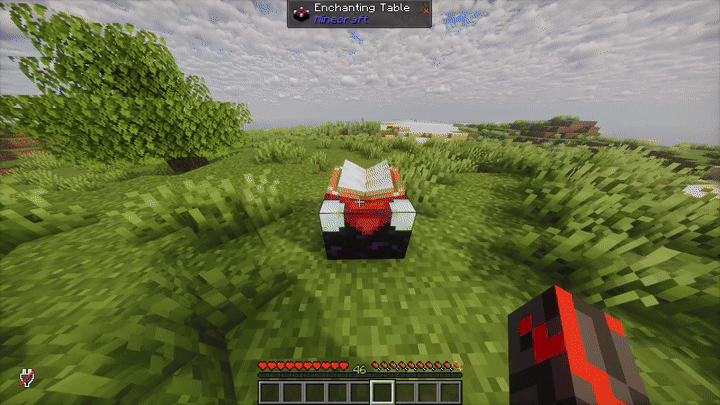

# Nouveau Enchanting

  

A complete, ground-up overhaul of Minecraft's Enchanting system inspired by Tinkers' Construct for Paper Minecraft Servers

## 🔮 Material-Based Enchanting:
Enchant your tools, weapons, and armor incrementally by using materials and exp instead of farming for villagers or gambling for the right enchants in the enchanting table.

For example, to add Sharpness 1 to a sword, you go to the enchanting table with some nether quartz. The table will take 4 levels and 8 quartz to apply Sharpness 1. Then, to apply Sharpness 2, take that sword with Sharpness 1, put it back in the table with some more quartz, and it will take 6 levels and 4 quartz and apply Sharpness 2, and so on and so forth.

This all comes complete with a GUI that (optionally) replaces the vanilla Enchanting Table with an item previewing the level and material cost of every enchant you try to apply. With a default configuration, it looks like this:

Everything in the plugin is configurable via the materials.yml file and you can make any material correspond to any enchantment. You can even use custom materials added by other plugins! Here is a list of common plugins and whether or not Nouveau Enchanting supports them:

| Plugin |Has Support   |
| ------------ | ------------ |
|ItemsAdder  | ✅  |
|ServerLevels| ✅ (v 1.0.1) |
| Oraxen  | ❌  |
|CraftEngine| ✅ (v 1.0.1) |

Please note: **changes to your materials.yml file require a full server restart to apply!**
## ✨ Vanilla Enchant Overrides:
Using Paper's new Registry API, this plugin allows you to directly modify the vanilla game's Enchants. Currently you can change an Enchant's:
- **Max level**
- **Allowed items** - what items it can be applied to, using items or any vanilla/datapack item tag (like `#swords`)
- **Primary items** - what items it can show up on in the vanilla enchanting table and random loot
- **Conflicts** - which other Enchants it can't be combined with
- **Tags** - where it can be found (enchanting tables, loot, villager trades, treasure-only, etc.)
- **Name** - with MiniMessage formatting and translatable text
- **Anvil cost, weight, and min/max enchanting cost**
- **Active slots** - which equipment slots it works in
- **Effects** - what the Enchant actually does (see below)

Every setting is optional. Anything you leave out keeps its vanilla value.

### Enchant Effects
You can also change what vanilla Enchants *do*, such as how much damage Sharpness adds or how much Protection protects you. Effects use Minecraft's own enchantment system, so they work everywhere with no extra lag. Currently you can change:
- **Combat** - damage, damage protection, knockback, armor effectiveness, mace smash damage
- **Durability and experience** - durability loss, Mending repair, block and mob experience
- **Projectiles, crossbows and tridents** - ammo use, projectile count/spread/piercing, crossbow charge time, trident return speed and spin attack strength
- **Fishing** - fishing time and luck
- **Mob drops** - equipment drop chance
- **Attributes** - any attribute, like movement speed, attack speed or max health, while the item is held or worn
- **Curses** - preventing an item from dropping on death or being taken off

Effects can stay the same at every level or scale with the Enchant's level. They can replace an Enchant's existing effects or be added on top of them.

All of this is done in the plugin's enchants.yml file, which comes pre-configured with every enchant in the game set to their vanilla values. See the [Wiki](https://github.com/MidenTheDev/NouveauEnchantingV2/wiki) for every setting and effect. **Updates to this file require a full server restart!**

## 🧪 Custom Enchants:
Nouveau Enchanting lets you add brand new Enchants to the game. Custom Enchants work with everything above: they can be used as results in materials.yml, and every one of their settings can be changed in enchants.yml. There are three ways to make them:
- **No code** - write the Enchant in a `.yml` file in the plugin's `addons` folder, using the same settings and effects as enchants.yml. An `example-enchants.yml` is created there to get you started.
- **Addons** - small jar files placed in the `addons` folder. An addon can give its Enchants effects, custom behavior written in Java, or both.
- **Other plugins** - any Paper plugin can register its own Enchants through the Nouveau Enchanting API.

The plugin also has events for developers that fire whenever an item is enchanted or disenchanted, whether that's from the enchanting GUI, the vanilla enchanting table, an anvil, a grindstone or a command.

See the [Wiki](https://github.com/MidenTheDev/NouveauEnchantingV2/wiki) for guides on making custom Enchants and using the API.

## 💻 Commands:
**/ne reload** - Reloads the config.yml. Does **NOT** reload enchants.yml or materials.yml. Changes to these files require a full server restart.

**/ne opengui** - Opens the Enchanting GUI for yourself

**/ne opengui [player]** - Opens the Enchanting GUI for the specified player

## ⌚ Planned Features:
Eventually, I would like for this plugin to:
- Modify anvil behavior to block the application of enchanted books
- Modify Villager trades to remove enchanted books and enchanted tools (Likely as a separate plugin)
- Support more Enchant effects, such as effects that trigger when you hit something (like Fire Aspect) and effects that only apply in certain conditions (like Smite only working on undead mobs)

None of the above features are currently implemented in the plugin, but are planned for future updates.

## ❓ FAQ:

#### Q:  I Need Help! X Isn't working!
**A: **Check the relevant Wiki page. If the Wiki isn't helpful or you otherwise don't understand, join the Discord Server and ask for support there. (Discord W.I.P)

#### Q: Why does this plugin only support Paper and not Spigot?
**A:** This plugin makes extensive use of Paper's api, even using features that are still considered experiemental and not officially supported. To make a plugin that achieves the same result using Spigot, while possible, would be a massive undertaking and would be a lot laggier than this plugin is currently on Paper.

#### Q: Why does the Github repo say V2?
**A:** This plugin is actually the 2nd iteration of the plugin that I've made. The original V1 version was made with the Spigot API (rather than Paper) and had half the feautres with twice the lag. V1 never saw release since I was never fully satisfied with my work or the overall quality of my code.
